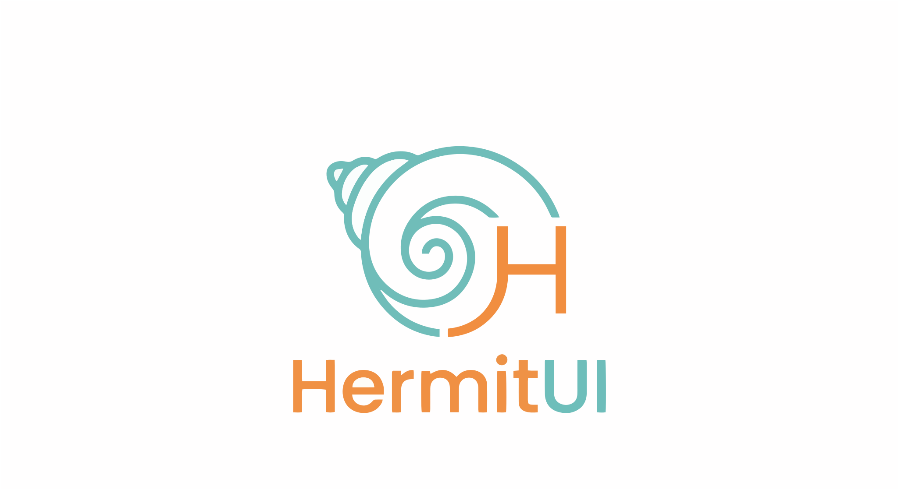
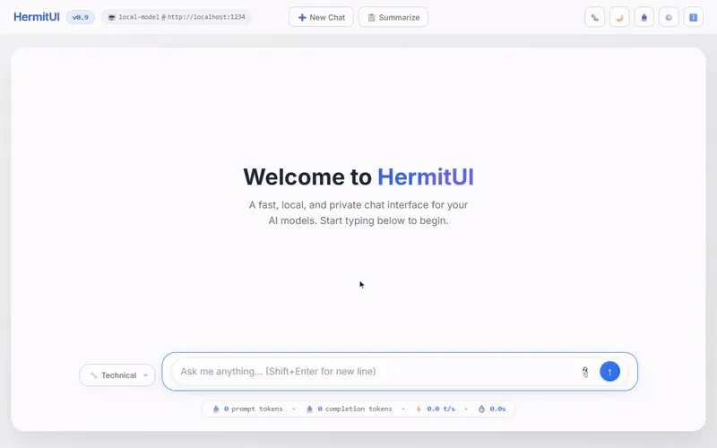

  
  
<i>A private chat UI for local AI models, in one HTML file.</i>

  

    
  

  
  
<i>A GGUF model downloads into memory (sped up) and answers in the browser tab with WebGPU.</i>

  
  
  
  

HermitUI is a chat interface that comes as one `.html` file. There is nothing to install: open the file and it runs. It can run GGUF models inside the browser tab, or talk to LM Studio, Ollama, llama.cpp, vLLM and any other OpenAI-compatible server. It stores nothing. When you close the tab, the chat and the model are gone.

It was made for machines where nothing else fits: air-gapped computers, locked-down company networks, shared desks.

## The four apps

Each one is a single HTML file that you can open from GitHub Pages or download and double-click.

| App | What it does | Try online | File |
|---|---|---|---|
| **HermitUI** | Chat client for your own model server | [Open](https://moooff.github.io/HermitUI) | [`dist/hermit-ui-standalone.html`](dist/hermit-ui-standalone.html) (3 MB) |
| **HermitUI in-browser** | The same chat, plus a model that runs in the tab: no server at all | [Open with Qwen3-0.6B](https://moooff.github.io/HermitUI/dist/hermit-ui-wllama.html#gguf=hf:unsloth/Qwen3-0.6B-GGUF/Qwen3-0.6B-Q4_K_M.gguf) | [`dist/hermit-ui-wllama.html`](dist/hermit-ui-wllama.html) (6.5 MB) |
| **[HermitUI Agent](#hermitui-agent)** | Hands a task to your model, which writes and runs Python in the tab while you watch and approve | [Open](https://moooff.github.io/HermitUI/hermit-agent/dist/hermit-agent-offline.html) | [`hermit-agent/dist/hermit-agent-offline.html`](hermit-agent/dist/hermit-agent-offline.html) (38 MB, numpy, pandas and matplotlib included), or [`hermit-agent-standalone.html`](hermit-agent/dist/hermit-agent-standalone.html) (11 MB, packages from a CDN) |
| **[HermitUI Cleaner](#hermitui-cleaner)** | Cleans AI-written text: hidden characters, typography, rewording with your model | [Open](https://moooff.github.io/HermitUI/hermit-cleaner/dist/hermit-cleaner-standalone.html) | [`hermit-cleaner/dist/`](hermit-cleaner/dist/) (0.4 MB, or 3.7 MB with an in-tab model) |

GitHub shows raw `.html` files as text, so to download one, right-click the link and choose *Save link as…*.

## Try it in 60 seconds

Open the [in-browser demo](https://moooff.github.io/HermitUI/dist/hermit-ui-wllama.html#gguf=hf:unsloth/Qwen3-0.6B-GGUF/Qwen3-0.6B-Q4_K_M.gguf). The link fills in Qwen3-0.6B (about 380 MB); confirm the banner and start chatting.

Or by hand:

1. Save [`dist/hermit-ui-wllama.html`](https://raw.githubusercontent.com/moooff/HermitUI/main/dist/hermit-ui-wllama.html) and open it in your browser.
2. Go to Settings → Backend Mode → **True Offline (Wllama GGUF)** and paste `hf:unsloth/Qwen3-0.6B-GGUF/Qwen3-0.6B-Q4_K_M.gguf` into the URL field.
3. Press **⬇️ Load** and chat.

## Running models in the browser

The in-browser build runs GGUF models with [wllama](https://github.com/ngxson/wllama), which is llama.cpp compiled to WebAssembly, with WebGPU when the browser has it. The engine is built into the file, so with a `.gguf` from disk the whole thing works offline. A model loaded by URL goes into memory only, never into browser storage.

Each link opens the in-browser build with that model filled in. Speeds are from an RTX 5070 Ti in Edge with WebGPU:

| Model | Download | Decode speed | Try it |
|---|---:|---:|---|
| Qwen3-0.6B | 0.4 GB | 79 t/s | [Run](https://moooff.github.io/HermitUI/dist/hermit-ui-wllama.html#gguf=hf:unsloth/Qwen3-0.6B-GGUF/Qwen3-0.6B-Q4_K_M.gguf) |
| Qwen3-1.7B | 1.1 GB | 73 t/s | [Run](https://moooff.github.io/HermitUI/dist/hermit-ui-wllama.html#gguf=hf:unsloth/Qwen3-1.7B-GGUF/Qwen3-1.7B-Q4_K_M.gguf) |
| Qwen3-4B ⭐ | 2.5 GB | 64 t/s | [Run](https://moooff.github.io/HermitUI/dist/hermit-ui-wllama.html#gguf=hf:unsloth/Qwen3-4B-GGUF/Qwen3-4B-Q4_K_M.gguf) |
| Qwen3-8B | 5.0 GB | 55 t/s | [Run](https://moooff.github.io/HermitUI/dist/hermit-ui-wllama.html#gguf=hf:unsloth/Qwen3-8B-GGUF/Qwen3-8B-Q4_K_M.gguf) |
| Gemma-4-E2B | 3.1 GB | 40 t/s | [Run](https://moooff.github.io/HermitUI/dist/hermit-ui-wllama.html#gguf=hf:unsloth/gemma-4-E2B-it-GGUF/gemma-4-E2B-it-Q4_K_M.gguf) |
| Gemma-4-E4B | 5.0 GB | 32 t/s | [Run](https://moooff.github.io/HermitUI/dist/hermit-ui-wllama.html#gguf=hf:unsloth/gemma-4-E4B-it-GGUF/gemma-4-E4B-it-Q4_K_M.gguf) |
| Gemma-4-12B | 7.1 GB | 36 t/s | [Run](https://moooff.github.io/HermitUI/dist/hermit-ui-wllama.html#gguf=hf:unsloth/gemma-4-12b-it-GGUF/gemma-4-12b-it-Q4_K_M.gguf) |
| gpt-oss-20b | 12.1 GB | 43 t/s | [Run](https://moooff.github.io/HermitUI/dist/hermit-ui-wllama.html#gguf=hf:ggml-org/gpt-oss-20b-GGUF/gpt-oss-20b-MXFP4.gguf) |

⭐ The best balance of speed and quality on a WebGPU machine. The files are `Q4_K_M` from [unsloth](https://huggingface.co/unsloth), except gpt-oss-20b (MXFP4 from [ggml-org](https://huggingface.co/ggml-org)). Gemma-4 takes 9-15 s before its first token, the others about 1 s. Without a GPU, stay at Qwen3-1.7B or smaller (about 10 t/s). Above about 3 GB, use Chrome or Edge: Safari and Firefox before 153 can't load such models, and WebGPU in Firefox is still slow. The full benchmark, a 13 GB Qwen3.8-27B and the browser details are in the [guide](docs/guide.md#benchmarks).

A link fetches the model again every session. To avoid that, press **💾 Save a copy to disk** under the URL field once, then load the file with the file picker next time. [More on this](docs/guide.md#download-once-reuse-offline).

## Connect your own server

The standalone build works with any server that speaks the OpenAI chat completions API.

1. Start your server: [LM Studio](https://lmstudio.ai/), [Ollama](https://ollama.com/), [llama.cpp](https://github.com/ggml-org/llama.cpp) or [vLLM](https://github.com/vllm-project/vllm).
2. Open `index.html` (or `dist/hermit-ui-standalone.html`).
3. Click **⚙️ Settings** and set the API URL, and the model name and key if needed.

| Server | API URL | Allow browser requests (CORS) |
|---|---|---|
| LM Studio | `http://localhost:1234/v1/chat/completions` | the CORS toggle in the server settings |
| Ollama | `http://localhost:11434/v1/chat/completions` | start with `OLLAMA_ORIGINS="*" ollama serve` |
| llama.cpp | `http://localhost:8080/v1/chat/completions` | on by default |
| vLLM | `http://localhost:8000/v1/chat/completions` | on by default |

"Network Error" usually means CORS. Per-server notes, a tuned llama-server config for a 27B on a 16 GB card, and cloud APIs are in the [guide](docs/guide.md#server-setup). A link can also carry the whole setup, e.g. `hermit-ui-standalone.html#api=http://localhost:8080/v1&model=qwen3-8b` ([URL parameters](docs/guide.md#configuration-via-url)).

### A server on another device (phone, tablet, second PC)

The model can run on one computer and HermitUI on another device, a phone on the same Wi-Fi for example. Two things have to be in place.

**1. The server listens on the network** and allows browser requests:

| Server | Listen on the network | Allow browser requests (CORS) |
|---|---|---|
| llama.cpp | `--host 0.0.0.0` | on by default |
| Ollama | `OLLAMA_HOST=0.0.0.0` | `OLLAMA_ORIGINS="*"` |
| LM Studio | "Serve on Local Network" | the CORS toggle |
| vLLM | `--host 0.0.0.0` | on by default |

The firewall has to let the port through. Anyone on that network can then use the model, so set an API key (`llama-server --api-key …`) if that matters.

**2. The page gets past mixed content.** The hosted page (`https://moooff.github.io/HermitUI/`) uses https, and browsers block an https page from calling a plain `http://` address other than `localhost`. Three ways around it:

- **Chrome asks instead of blocking** (desktop Chrome 142 and later): allow access to devices on your local network. On Android, Chrome first needs Android's own permission (Settings → Apps → Chrome → Permissions, "Nearby devices" or "Local network"). Safari and Firefox block the request.
- **Open HermitUI over http from the server.** Put `hermit-ui-standalone.html` into a folder as `index.html` and start llama.cpp with `--path <that folder>`. On the other device, open `http://<server-ip>:<port>/` and set the API URL to `http://<server-ip>:<port>/v1/chat/completions`. For other servers, any static file server works, e.g. `python3 -m http.server 8000 --bind 0.0.0.0` in `dist/`; Ollama then needs that page's origin in `OLLAMA_ORIGINS` (or `*`).
- **Give the server https.** With [Tailscale](https://tailscale.com/) on both devices, `tailscale serve --bg <port>` publishes the server as `https://<computer>.<tailnet>.ts.net` with a valid certificate, and the hosted page works as is, also away from home. A reverse proxy (Caddy, nginx) with a certificate the device trusts works too.

## Features

- Streaming replies with stats: tokens, tokens per second, duration, and how full the context window is.
- Reasoning models: `<think>`, `<thought>` and `<reasoning>` blocks fold away. A **🧠 Think** control sets the effort (Off, Low, Medium, High) where the model supports it; Off cut a 27B's answer from 58 s to 25 s.
- Markdown with code highlighting and copy buttons, LaTeX math (KaTeX, rendered to MathML), Mermaid diagrams and SVG images.
- Images for vision models (upload, drag and drop, or paste) and text files as context.
- Edit or regenerate any message and switch between the versions (‹ 1/2 ›). **⏩ Continue** picks up a reply that hit the token limit, **📄 Raw** shows what the model actually wrote.
- Personas (technical, general, writing, tutor) and sampling settings, sent only when you set them.
- Export a chat to Markdown and import it again later (`Ctrl+E`, `Ctrl+I`). The exported file is the only copy.
- Light and dark theme. Every library and the Inter font are inside the file.

## Privacy

HermitUI uses no `localStorage`, `IndexedDB`, cookies or model cache, and sends no telemetry. You can check this in a minute:

- Open DevTools → **Application** → **Storage** and use the app. Every store stays empty, also after a model has loaded.
- The Network tab shows requests only to the server or model URL you entered.
- `grep -o "localStorage\|sessionStorage\|indexedDB\|document\.cookie" dist/hermit-ui-standalone.html | wc -l` prints **2**. Both hits are in Highlight.js's list of JavaScript keywords.

Downloaded models go into an in-memory `Blob`. wllama's own URL loader would save them to [OPFS](https://developer.mozilla.org/en-US/docs/Web/API/File_System_API/Origin_private_file_system), so HermitUI doesn't use it (`downloadGgufToBlob` in [`src/script.js`](src/script.js)).

## HermitUI Agent

Give [HermitUI Agent](hermit-agent/) a task, like *"clean up these CSVs and chart the monthly totals"*. It writes Python and runs it in the tab with Pyodide, on the files you dropped in. Then it reads the output and picks the next step. You see what it thinks, the code it ran, what came out, and a diff of each file it changed. If a step wants to overwrite or delete a file, or go online, it waits for you to say yes. You can undo any step. The files live only in the tab, but you can export a session as a `.zip`.

You need an OpenAI-compatible server and a model that can fix its own mistakes. The reference tasks pass with Qwen3.8-27B. The sandbox blocks the network with a denylist: 17 known ways out are closed, but there may be more, so don't put secrets in the workspace. See the [agent README](hermit-agent/README.md) and the [design doc](hermit-agent/DESIGN.md).

## HermitUI Cleaner

[HermitUI Cleaner](hermit-cleaner/) cleans text another model wrote. It removes hidden characters and turns typography into what a keyboard types, can reword sentences or paragraphs, or the whole text, with your own model, and can add a few natural typos. One build uses a model server, the other can also run a small GGUF model in the tab. Details in the [cleaner README](hermit-cleaner/README.md).

## Building and contributing

Edit `src/` and run `python3 build.py`; never edit the files in `dist/`. The build needs only Python 3, plus the network the first time to download the pinned libraries. Tests: `node tests/run.mjs`, and the end-to-end tests described in [`tests/README.md`](tests/README.md). Details in the [guide](docs/guide.md#building).

[Issues](https://github.com/moooff/HermitUI/issues) and pull requests are welcome. Please read [`AGENTS.md`](AGENTS.md) first: one file, vanilla JS, no storage of any kind, all model output through DOMPurify. A change that breaks one of these rules can't be merged. For bugs in the in-browser mode, include your browser and version, whether WebGPU was on, the model, and the debug console output at verbosity **Debug**.

## License

[GNU AGPL v3](LICENSE).
